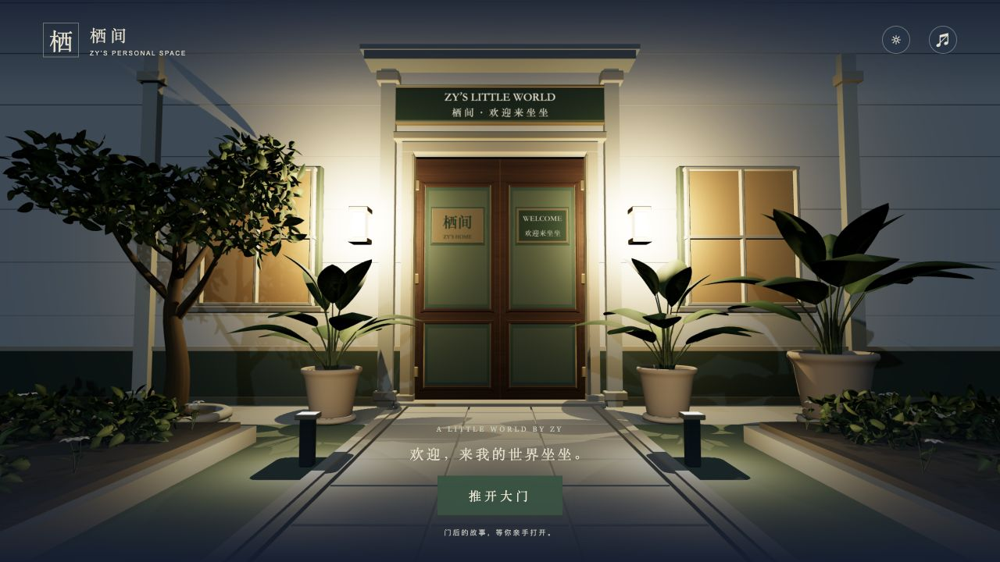
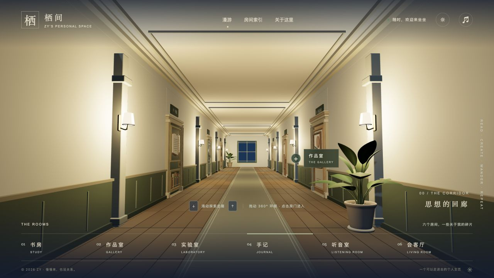
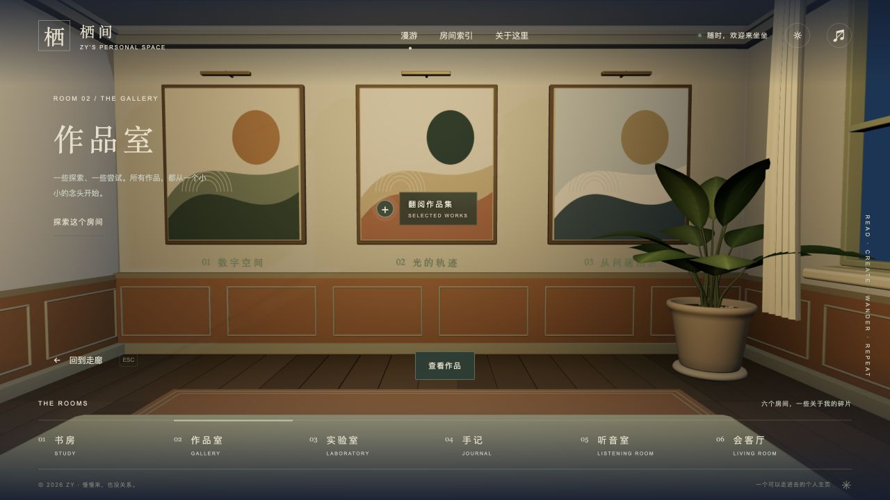
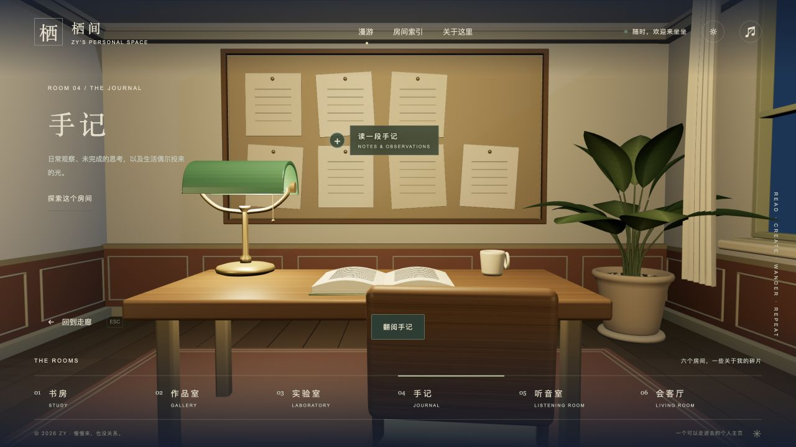
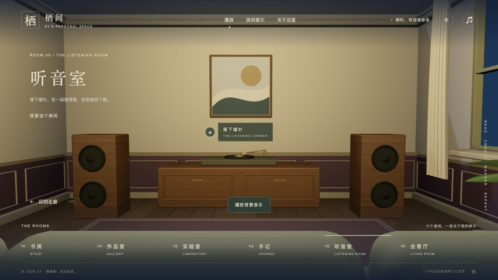
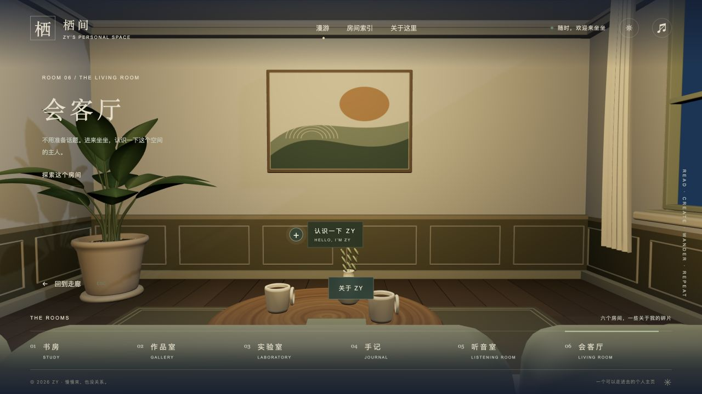

# 栖间 · 公开空白版

可以走进去的 3D 个人主页：推开大门，沿走廊探索书房、作品室、实验室、手记、听音室和会客厅。

本版本保留场景与交互，书房的课程和书籍列表为空，不包含课程 PDF、原资料清单、个人笔记或私人仓库历史。作品、随笔与个人介绍保留演示内容；书房中的实体书本是场景装饰。

## 场景预览

实际运行截图；书房仅保留场景装饰，资料目录为空。

### 推开大门



### 沿着走廊探索



| 书房 | 作品室 |
| --- | --- |
|  |  |
| 实验室 | 手记 |
|  |  |
| 听音室 | 会客厅 |
|  |  |

## 本地运行

使用 Node.js 24（见 `.nvmrc`）。

```bash
npm ci
npm run dev
```

## 检查与构建

```bash
npm test
npm run build
npm run preview
```

构建结果位于 `dist/`。构建保留可选 PDF 代理，但未绑定存储桶；空白版无需 R2 即可使用。

## 修改内容

- `src/library.js`：课程与书籍目录，当前均为空数组。
- `src/content.js`：房间信息、作品与演示随笔。
- `src/main.js`：面板、空书架、笔记、书签与音乐交互。
- `src/scene.js`：三维场景与物件交互。
- `src/style.css`、`index.html`：界面样式和文字。
- `public/audio/lullaby.mp3`：背景音乐。

笔记和书签仅存于访客自己的浏览器，不上传到仓库或服务器。若自行添加 PDF，可使用本地 `public/books/` 目录；生产构建不会复制该目录，生产阅读需自行配置 PDF 地址或可选的 `functions/books/[[path]].js` 与 `books` R2 绑定。

## GitHub 与部署

公开仓库：[EFZzy/zy-home-public](https://github.com/EFZzy/zy-home-public)。主分支为 `main`。

Cloudflare Pages 构建命令为 `npm run build`，输出目录为 `dist`，根目录留空。可选 CLI 发布命令 `npm run deploy` 指向独立的 `zy-home-public` 项目，需要自行创建该 Pages 项目并登录。本仓库不会配置或更新其他站点。

## 参考与素材

空间交互结构参考 [ITomPoland/portfolio-itom](https://github.com/ITomPoland/portfolio-itom)。PDF.js 的许可证及相关字体、解码资源许可保留于 `public/pdfjs/`。
